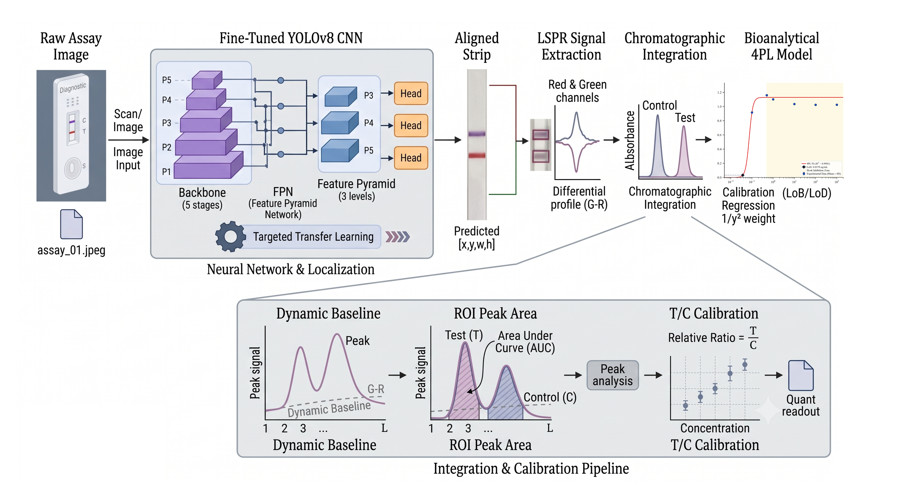
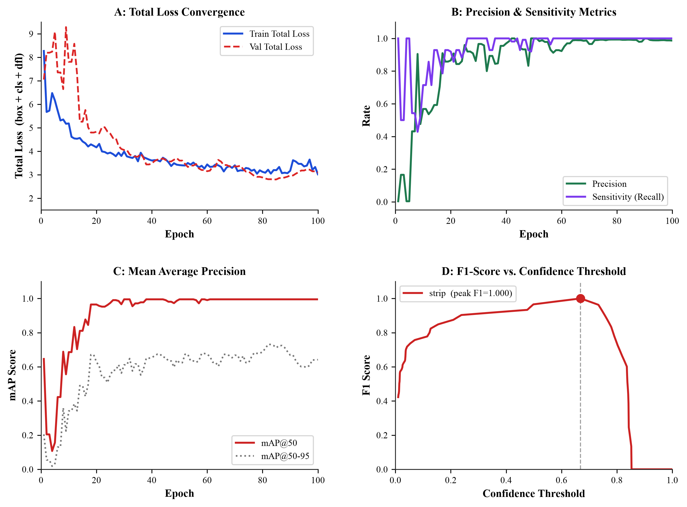
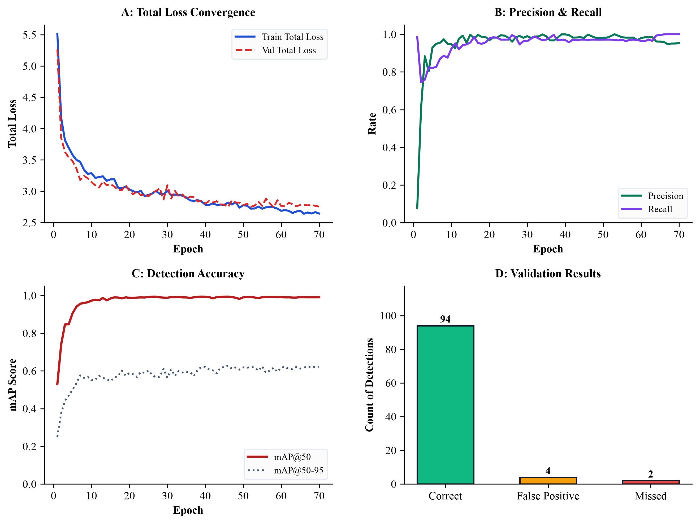
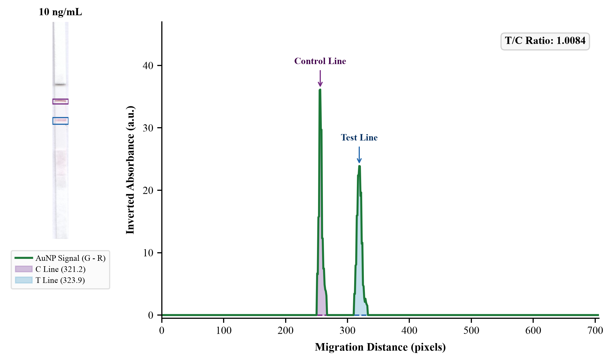
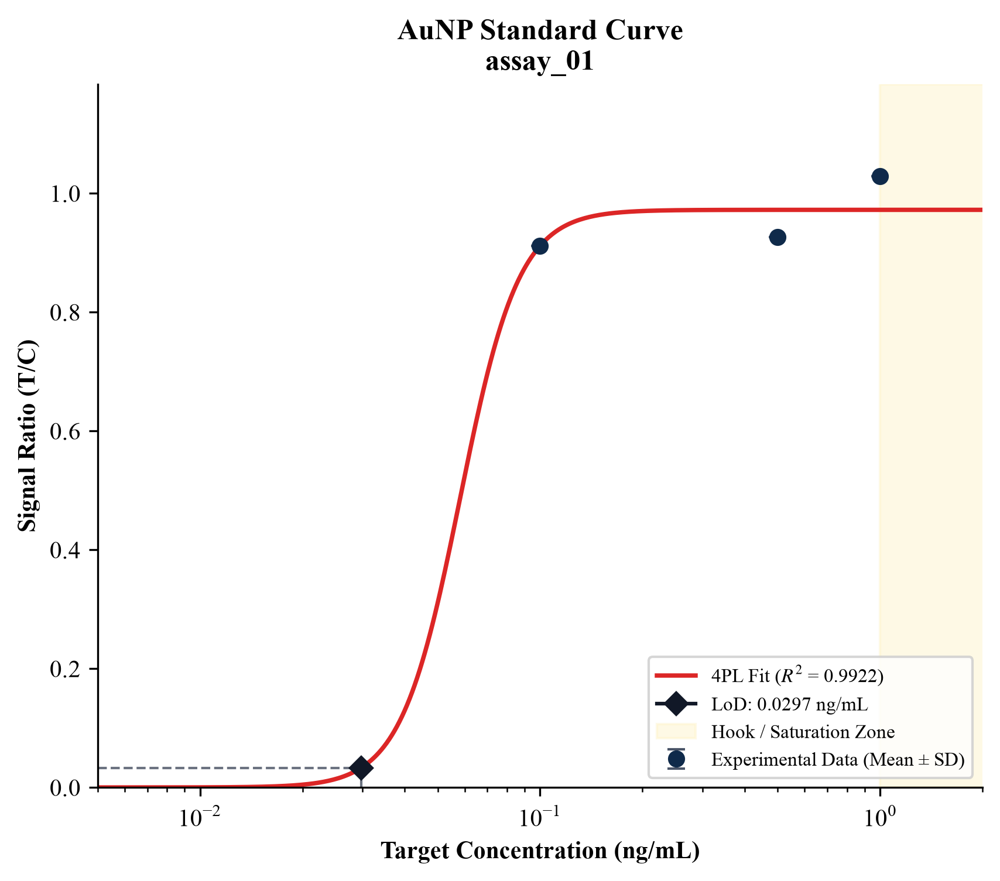

[](https://doi.org/10.5281/zenodo.23160097)
[](https://colab.research.google.com/github/harishs-io/lateral_flowimmunoassay_quant/blob/main/notebooks/lfia_quant.ipynb)
[](https://www.python.org/downloads/)
[](https://opensource.org/licenses/MIT)
[](https://github.com/ultralytics/ultralytics)

# Deep Learning Framework for Lateral Flow Immunoassay Analytics

An end-to-end computer vision and bioanalytical pipeline for point-of-care **colloidal gold (AuNP) Lateral Flow Immunoassays (LFIA)**. The pipeline combines a **YOLOv8 deep learning architecture**, **localized surface plasmon resonance (LSPR) differential spectroscopy**, **adaptive chromatographic peak integration**, **$1/y^2$ weighted Four-Parameter Logistic (4PL) regression**, and **CLSI EP17-compliant analytical Limit of Detection (LoD)** calculation.

---

<div align="center">
  
  <p><em>Figure 1: Complete Two-Stage Cascaded LFIA Quantification Pipeline: (1) Stage 1 Nitrocellulose Strip Localization, (2) Stage 2 Sub-Pixel C & T Band Detection, (3) LSPR Differential Spectroscopy & Morphological Baseline Subtraction, and (4) Weighted 4PL Calibration with CLSI EP17 LoD Determination.</em></p>
</div>

---

## Key Scientific & Engineering Highlights

* **YOLOv8 Architecture:**
  * **Stage 1 (Strip Localization & Crop):** Localizes and segments the nitrocellulose membrane strip from raw, cluttered smartphone or flatbed images with sub-millimeter precision. Achieves **99.5% mAP@50**, **98.9% Precision**, and **99.1% Recall** at **7.4 ms** inference latency.
  * **Stage 2 (Band Detection & Classification):** Directly inspects the cropped strip to simultaneously classify and predict sub-pixel bounding coordinates for the **Control (C)** line (class 0) and **Test (T)** line (class 1). Achieves **99.1% mAP@50**, **97.2% Precision**, and **98.7% Recall** at **8.3 ms** inference latency.
* **Physics-Informed LSPR Differential Contrast:** Exploits the localized surface plasmon resonance of colloidal gold nanoparticles ($\lambda_{\text{abs}} \approx 525–535\text{ nm}$) against the nitrocellulose membrane scattering background ($\lambda_{\text{ref}} \approx 650\text{ nm}$), calculating differential optical density $\Delta A(y) = I_{\text{Red}}(y) - I_{\text{Green}}(y)$ with complete suppression of non-specific lighting gradients.
* **Longitudinal Continuum Baseline & Gated AUC Integration:** Utilizes structural morphological grey opening to eliminate membrane unevenness and vignetting. Band integration enforces a 5% apex boundary cutoff and a strict noise prominence gate ($> 5.0\text{ a.u.}$), preventing false-positive peaks on blank control strips.
* **Weighted 4-Parameter Logistic (4PL) Calibration:** Solves dynamic non-linear ligand-receptor binding curves weighted by inverse variance ($1/y^2$) to anchor accuracy at low concentrations. Automatically flags high-dose prozone/hook effects and membrane binding saturation plateaus.
* **CLSI EP17 Compliance:** Rigorously calculates the Limit of Blank (LoB) and Limit of Detection (LoD) using non-parametric blank and low-concentration replicate variances:
  $$\text{LoB} = \mu_{\text{blank}} + 1.645 \cdot \sigma_{\text{blank}}$$
  $$\text{LoD} = \text{LoB} + 1.645 \cdot \sigma_{\text{low}}$$

---

## Neural Network Performance Metrics

### Stage 1: Nitrocellulose Strip Detector (YOLOv8 Nano)
Trained on full assay photographs across diverse illumination angles, focal distances, and background clutter.

| Metric | Score |
| :--- | :--- |
| **Precision** | **98.9%** |
| **Recall** | **99.1%** |
| **mAP@50** | **99.5%** |
| **mAP@50-95** | **92.3%** |
| **Inference Latency** | **7.4 ms** (CPU) |

<div align="center">
  
  <p><em>Figure 2: Stage 1 Strip Detector Performance: Loss convergence, precision-recall curve, F1 confidence curves, and cross-validation matrix.</em></p>
</div>

### Stage 2: Control & Test Band Detector (YOLOv8 Nano)
Trained on 409 cropped strips with 633 validated bounding box annotations spanning 0 to 100 ng/mL concentrations.

| Metric | Score |
| :--- | :--- |
| **Precision** | **97.2%** |
| **Recall** | **98.7%** |
| **mAP@50** | **99.1%** |
| **mAP@50-95** | **67.6%** |
| **Inference Latency** | **8.3 ms** (CPU) |

<div align="center">
  
  <p><em>Figure 3: Stage 2 Band Detector Performance: Training loss convergence, mAP trajectory across reinforcement retraining, precision-recall curve, and validation results.</em></p>
</div>

---

## Signal Processing & Chromatographic Extraction

### 1. Colloidal Gold Optical Physics
Gold nanoparticles (AuNPs) exhibit a strong surface plasmon absorption band around 530 nm (green channel) while transmitting and reflecting red wavelengths (~650 nm). By converting raw pixel intensities into inverted absorbance space:
$$A_{\text{Green}}(y) = 255 - I_{\text{Green}}(y)$$
$$A_{\text{Red}}(y) = 255 - I_{\text{Red}}(y)$$
$$\Delta A(y) = A_{\text{Green}}(y) - A_{\text{Red}}(y) = I_{\text{Red}}(y) - I_{\text{Green}}(y)$$

### 2. Dual-Panel Quantitative Visualizations
Every analyzed sample produces a standardized publication-ready figure featuring the localized strip on the left (with Purple bounding box for C-line and Blue bounding box for T-line) and the baseline-corrected chromatogram on the right:

<div align="center">
  
  <p><em>Figure 4: Automated analytical output for a 10 ng/mL sample showing Stage 2 bounding box localization (left) and baseline-subtracted LSPR area integration (right).</em></p>
</div>

### 3. Blank vs. Positive Differentiation
On true blank strips, the noise gating algorithm automatically clamps the test line signal to $T = 0.0000$, producing an unequivocal $T/C = 0.0000$ ratio and eliminating baseline inflation:

| Sample Concentration | Control Area (C) | Test Area (T) | T/C Ratio | Status |
| :--- | :--- | :--- | :--- | :--- |
| **Blank (0 ng/mL)** | 237.31 | **0.0000** | **0.000000** | Verified Negative / Blank |
| **0.1 ng/mL** | 174.02 | 158.66 | **0.911731** | Analytical Positive |
| **0.5 ng/mL** | 305.70 | 283.05 | **0.925925** | Analytical Positive |
| **1.0 ng/mL** | 301.81 | 310.61 | **1.029150** | Analytical Positive |

### 4. Calibration & Limit of Detection Curve
Replicate data points across standard concentrations are fitted using an inverse-variance weighted 4PL model:

<div align="center">
  
  <p><em>Figure 5: 4-Parameter Logistic (4PL) Calibration Curve with experimental replicates (Mean ± SD), CLSI EP17 Limit of Detection marker (black diamond), and saturation/hook region.</em></p>
</div>

---

## Image Formatting & Naming Requirements

To enable automated replicate grouping and calibration, organize your images with the following naming standard:
* **Format:** `[concentration]_[replicate_number].[ext]` (e.g., `0_1.png` or `Blank_1.jpg`, `0.1_1.jpeg`, `1_2.png`, `10_1.jpg`).
* **Assay Chemistry:** Colloidal gold (AuNP) nitrocellulose test strips.
* **Framing:** One single test strip per image.

---

## Quickstart Guide

### Option A: Run in Google Colab (Zero Installation)
Click the badge below to run the complete interactive pipeline directly in your web browser with GPU acceleration:

[](https://colab.research.google.com/github/harishs-io/lateral_flowimmunoassay_quant/blob/main/notebooks/lfia_quant.ipynb)

1. Run **⚙️ 1. Environment Setup** to install requirements and load dual weights.
2. Run **🔬 2. Upload Image & Run Two-Stage Pipeline** to select strip images from your local drive.
3. Review interactive HTML cards with real-time T/C ratios, chromatograms, and 4PL curve.
4. Run **📊 3. Export Data & Reports** to download `LFIA_TwoStage_Results.zip`.

---

### Option B: Local Command Line Installation

```bash
# 1. Clone the repository
git clone https://github.com/harishs-io/lateral_flowimmunoassay_quant.git
cd lateral_flowimmunoassay_quant

# 2. Create and activate a virtual environment
python3 -m venv venv
source venv/bin/activate

# 3. Install required packages
pip install -r requirements.txt
pip install -e .

# 4. Run the two-stage pipeline on demo data
python src/lfia_analyzer.py --input_dir demo_data/assay_01
```

### CLI Command Options:
```bash
python src/lfia_analyzer.py \
    --input_dir "path/to/assay_folder" \
    --strip_weights "weights/best_strip_detector.pt" \
    --band_weights "weights/best_band_detector.pt" \
    --strip_conf 0.45 \
    --band_conf 0.30
```

---

## Repository Structure

```text
lateral_flowimmunoassay_quant/
├── assets/                               # Publication plots, diagrams, and graphical abstract
│   ├── workflow.png
│   ├── Stage1_Strip_Detector_Publication_Metrics.png
│   ├── Stage2_Band_Detector_Publication_Metrics.png
│   ├── sample_10ng_Analysis_Plot.png
│   └── standard_curve_demo.png
├── demo_data/                            # Demonstration assay strips for instant testing
│   └── assay_01/
│       ├── Blank_1_AuNP.jpeg
│       ├── 0.1_1_AuNP.jpeg
│       ├── 0.5_1_AuNP.jpeg
│       └── 1_1_AuNP.jpeg
├── notebooks/                            # Interactive Google Colab notebook
│   └── lfia_quant.ipynb
├── src/                                  # Modular Python source packages
│   ├── __init__.py
│   ├── calibration.py                    # 4PL regression, hook detection, & CLSI EP17 LoD
│   ├── detector.py                       # Stage 1 auto-crop & Stage 2 band detection
│   ├── lfia_analyzer.py                  # Master batch pipeline & report generator
│   ├── signal_processing.py              # LSPR (G - R) physics, baseline, & gated AUC
│   └── utils.py                          # Filename parsing & MD5 continuous learning hashes
├── weights/                              # Production YOLOv8 model weights
│   ├── best_strip_detector.pt            # Stage 1 model (5.9 MB, 99.5% mAP)
│   ├── best_band_detector.pt             # Stage 2 model (5.9 MB, 99.1% mAP)
│   └── best.pt                           # Fallback weights
├── LICENSE                               # MIT License
├── README.md                             # Repository technical documentation
├── requirements.txt                      # PIP dependency specifications
└── setup.py                              # Package installation manifest
```

---

## Citation & Contact

If you use this pipeline or its pretrained YOLOv8 models in your research, please cite:

```bibtex
@software{lfia_quant_2026,
  author       = {Harish S.},
  title        = {Deep Learning Framework for Lateral Flow Immunoassay Analytics},
  year         = {2026},
  publisher    = {Zenodo},
  doi          = {10.5281/zenodo.23160097},
  url          = {https://github.com/harishs-io/lateral_flowimmunoassay_quant}
}
```

**License:** MIT License. Free for academic and commercial use.
